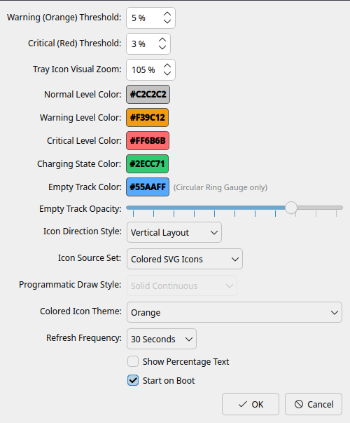
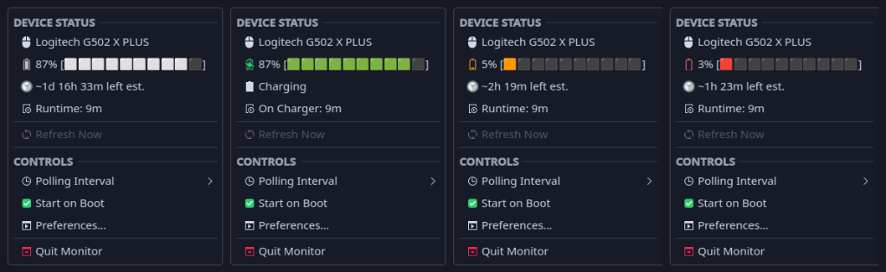
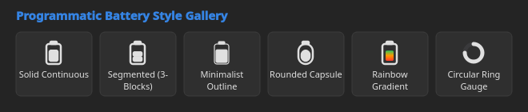
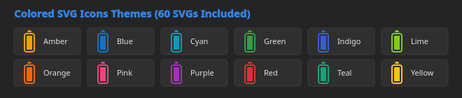

# Logitech Battery Monitor System Tray

[](https://github.com/PlasmaDrifter/logitech-battery-tray)
[](https://www.python.org/)
[](https://pypi.org/project/PySide6/)
[](https://kde.org/plasma-desktop/)
[](LICENSE)

A lightweight, feature-rich system tray battery monitor for Logitech wireless mice (such as the G502 X, PRO X Superlight, G305, etc.) on Linux desktops. Built natively with Python and PySide6/PyQt5, it provides real-time charge monitoring, battery depletion rate estimation, custom vector layouts, and colored icon themes with zero background CPU overhead.

---

## Previews

### Settings & Preferences


### System Tray Menu & Battery States


### Programmatic Battery Layout Styles


### Colored SVG Theme Icons (60 Vector SVGs Included)


---

## Features

- **Direct HID Probing**: Low-level communication over `/dev/hidraw*` with Logitech receivers for fast, accurate battery reports without daemon overhead.
- **Dynamic Condition Colored Progress Bar**: Visual battery level indicator in the context menu with condition colors:
  - 🟩 **Charging**
  - ⬜ **Normal Discharging**
  - 🟧 **Warning Threshold** (guaranteed minimum 1-block display)
  - 🟥 **Critical Threshold** (guaranteed minimum 1-block display)
  - ⬛ **Empty Capacity Slots**
- **Configurable Desktop Notifications**: Native desktop notifications when crossing **Critical**, **Warning**, and **Full Charge** thresholds, each with an independent enable/disable toggle.
- **Smart Notification Latching**: Anti-spam latching alerts only once per threshold crossing and resets automatically when battery state changes.
- **Configurable Full Charge Threshold**: User-adjustable threshold (80%–100%) to reset the runtime clock and discharge cycle estimator without waiting for 100% trickle charging.
- **Hours-Remaining Estimator**: Adaptive drain-rate algorithm with suspend/shutdown interval filtering and moving average smoothing.
- **Last Charge Timestamp Tracking**: Real-time counter of total runtime elapsed since the last full charge.
- **6 Programmatic Vector Styles**:
  - **Solid Continuous**
  - **Segmented (3 Blocks)**
  - **Minimalist Outline**
  - **Rounded Capsule**
  - **Rainbow Gradient**
  - **Circular Ring Gauge**
- **60 Included Colored SVG Theme Icons**: Full multi-level icon packs across 12 distinct color themes.
- **Vertical & Horizontal Layouts**: Custom icon orientations tailored to top, bottom, or vertical panel docks.
- **Real-Time Live Previews**: Changes in the Preferences dialog apply immediately to the tray icon and menu.
- **Native KDE Breeze & Dark Theme Support**: Follows system palette with custom color pickers for every battery state.
- **Autostart Support**: Easily toggle boot autostart directly from the context menu or Preferences.

---

## Requirements & Dependencies

- **Python**: 3.8 or higher
- **GUI Framework**: `PySide6` (or `PyQt6` / `PyQt5`)
- **Process Utility**: `setproctitle` (optional)
- **System Permissions**: Read/Write access to `/dev/hidraw*` device nodes (configured via udev rule).

---

## Installation

### Automated Installation (Recommended)

Clone the repository and run the installer:

```bash
git clone https://github.com/PlasmaDrifter/logitech-battery-tray.git
cd logitech-battery-tray
chmod +x install.sh
./install.sh
```

#### Installer Options
- **Enable Autostart on Boot**:
  ```bash
  ./install.sh --autostart
  ```
- **Install Logitech HID++ udev Rules (requires sudo)**:
  ```bash
  ./install.sh --udev
  ```

#### What `install.sh` Does
1. Verifies Python 3 (>= 3.8) and installs any missing Python packages via pip if necessary.
2. Installs application files to `~/.local/share/logitech-battery-tray/`.
3. Creates a command-line launcher at `~/.local/bin/logitech-battery-tray`.
4. Installs the vector application icon to `~/.local/share/icons/hicolor/scalable/apps/logitech-battery-tray.svg`.
5. Installs the desktop application launcher to `~/.local/share/applications/logitech-battery-tray.desktop`.
6. Checks for Logitech USB receiver udev permissions and refreshes system icon and desktop databases.

---

### Manual Installation (Alternative)

#### 1. Install Python Dependencies
```bash
pip install -r requirements.txt
```

#### 2. Setup USB udev Permissions (Linux)
To allow querying Logitech receiver devices without running as root, add your user to the `input` or `plugdev` group and install a udev rule:

```bash
# Add udev rule for Logitech HID++ receivers
echo 'KERNEL=="hidraw*", SUBSYSTEM=="hidraw", ATTRS{idVendor}=="046d", MODE="0666"' | sudo tee /etc/udev/rules.d/99-logitech-wheel.rules

# Reload udev rules
sudo udevadm control --reload-rules
sudo udevadm trigger
```

---

## Uninstallation

To remove the application, CLI launcher, desktop entries, and icons:

```bash
chmod +x uninstall.sh
./uninstall.sh
```

To also delete saved user configurations (`~/.config/logitech-battery-tray`):

```bash
./uninstall.sh --purge
```

---

## Usage

Launch the application using any of the following methods:

- **Application Menu**: Search for **Logitech Battery** in your desktop environment's launcher (KDE Plasma, GNOME, etc.).
- **Command Line**: Run `logitech-battery-tray` from any terminal.
- **Direct Script**: Run `python3 logitech_battery.py` from the project directory.

### System Tray Right-Click Menu
- **Logitech Device**: Connected device model name.
- **Battery Status & Progress Bar**: Live battery percentage, condition-colored progress bar, and status icon.
- **Estimated Time Left**: Remaining hours estimate calculated from recent discharge rate.
- **Charging State**: Visual indicator displayed when device is connected to a charger.
- **Runtime Tracker**: Elapsed active time since reaching the full charge threshold (or time on charger).
- **Refresh Now**: Force an immediate battery query.
- **Polling Interval**: Select background polling frequency (5s, 10s, 30s, 60s).
- **Start on Boot**: Enable or disable user session autostart.
- **Preferences...**: Configure thresholds, notifications, vector styles, colors, and visual scale.

---

## Configuration

Settings are saved in standard INI format at:
`~/.config/logitech-battery-tray/Settings.conf`

---

## License

This project is licensed under the [MIT License](LICENSE).

---

## Community & Discussions

Got questions, setup ideas, or feedback?

* Join our subreddit at [**r/PlasmaDrifterProjects**](https://reddit.com/r/PlasmaDrifterProjects) to discuss updates, get support, and share configurations.
* Contact directly via email at [**plasmadrifter121@gmail.com**](mailto:plasmadrifter121@gmail.com).

